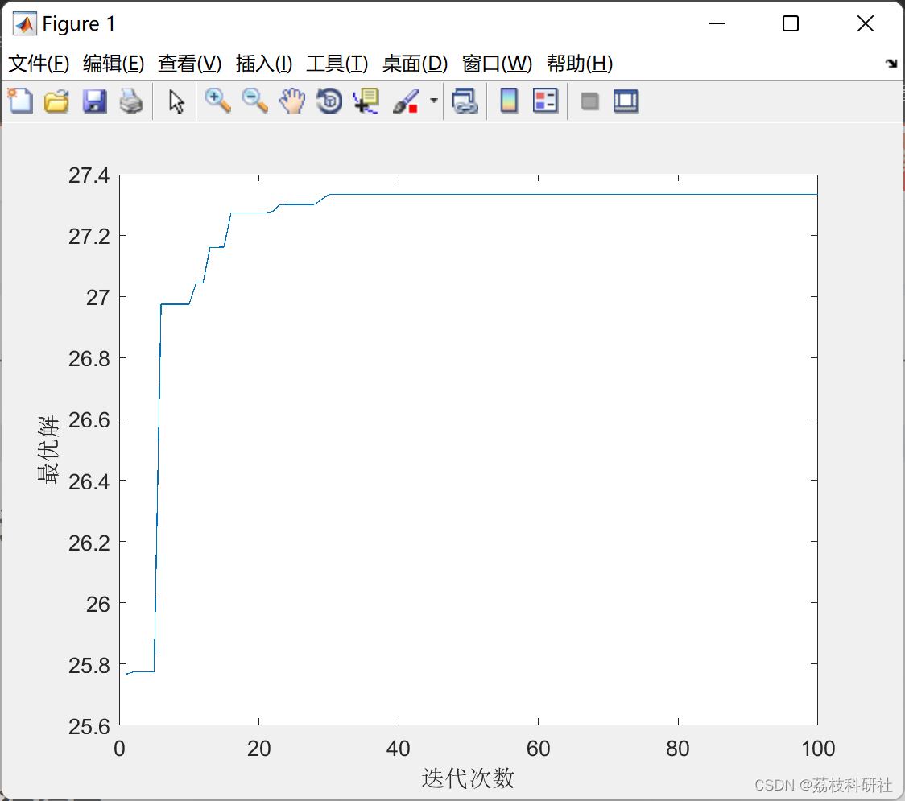

# Duel Optimizer: An Algorithm Inspiration from the Duelers' Ability Improvement in a Duel (Matlab Code Implementation)

📚2 Running Results Edit
Part of the code:
for k = 1:Population  
for ii=1:Dimension  
X0(ii,k) = (((DuelistInteger(k,ii)+1)/(10^FightCapabilities))*RangeB(ii))+LB(ii);  
end  
cost = -((((X0(1,k).^2)+(X0(2,k).^2)).^0.5).*cos((X0(1,k))-(X0(2,k)))).*exp(cos(((X0(1,k)).*(X0(2,k)+5))./7));  
fitness = cost;  
Datafit = [Datafit; fitness];  
end  
Data1fit = Datafit;  
[fitnessmax, nmax] = max(Data1fit);  
DataFDAfit = [DataFDAfit;fitnessmax];  
DuelistMax = Duelist(nmax,:);  
DuelistMaxLast = DuelistMax;  
Hasilmax = DuelistMax;  
sort = [Duelist Datafit];  
maxall = [maxall; sort];  
for i = 1:Dimension  
HasilMaxtemp1 = Hasilmax(1,(((i*FightCapabilities)-FightCapabilities)+1):(i*FightCapabilities));
HasilMaxtemp2 = num2str(HasilMaxtemp1);  
HasilMaxtemp3 = HasilMaxtemp2(~isspace(HasilMaxtemp2));  
HasilMaxInt(1,i) = str2num(HasilMaxtemp3);  
end  
HMIt = [];  
for ij=1:Dimension  
HMIt = [HMIt, HasilMaxInt(1,ij)];  
end  
HMI = [HMI; HMIt];  
end  
plot(DataFDAfit);  
xlabel('Iterations')
ylabel('Optimal Solution')
hold on  
[fitnessmaxf, nmaxf] = max(DataFDAfit);  
for ik=1:Dimension  
X0maxfix(ik) = (((HMI(nmaxf,ik)+1)/(10^FightCapabilities))*RangeB(ik))+LB(ik);  
end  
X0maxfix  
[fitnessmaxf, nmaxf] = max(DataFDAfit)  
convergemax = [convergemax;fitnessmaxf];  
convergeiter = [convergeiter;nmaxf];  
xmax = [xmax;X0maxfix];  
DFDAfit = [DFDAfit,DataFDAfit];  
🌈3 Matlab code implementation
🎉4 References
​  

## Images

<!-- PAYMENT_BLOCK -->

## Get this dataset

- Payment link (Stripe): [Buy now](https://buy.stripe.com/3cs8yP7sY87d0vu9AB)
- Payment QR code: 

<!-- /PAYMENT_BLOCK -->
